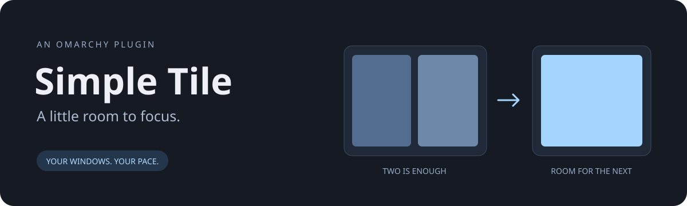
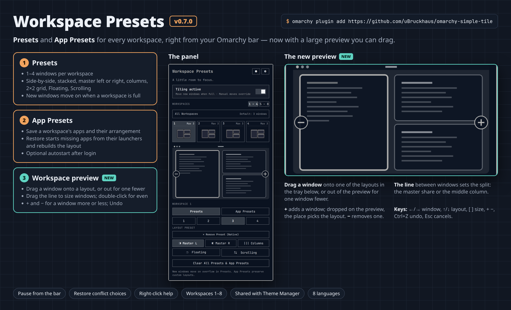

# Workspace Presets



**Presets and App Presets for every workspace, right from your Omarchy bar.**

- **Presets** give a workspace a window limit (1–4) and a tiling layout:
  side-by-side, stacked, master left or right, columns, or a 2×2 grid. New
  windows that don't fit move on to the next workspace with room. Or let a
  workspace float (every window moves and resizes freely, like on a classic
  desktop) or scroll (full-height columns on a strip you scroll through).
  With Omarchy 4.5 these are the workspace's own Omarchy mode, the one
  **Super + L** cycles, so both always agree.
- **App Presets** save the apps on a workspace and how they are arranged.
  Restore opens any missing apps and rebuilds the layout, with one click or
  automatically after login.



- **Room to focus:** set a limit of 1–4 windows globally or per workspace.
  New overflow windows move forward to a workspace with room; focus follows.
- **Layouts at a click:** side-by-side, stacked, master-left, master-right,
  columns, a 2×2 grid, Floating and Scrolling. Native mode removes limits and automatic overflow.
- **Your apps, your arrangement:** save an App Preset with window geometry
  and app icons, launch missing apps, and rebuild the saved layout.
- **Restore on your terms:** move conflicting windows, close them, keep them
  floating, or cancel. Optional auto-move makes repeat restores quicker.
- **Ready after login:** optionally restore saved workspaces once per
  Hyprland session.
- **At home in Omarchy:** native controls, workspace cards, contextual
  right-click help, and a right-click pause button on the bar.

See the [user manual](MANUAL.md) for controls and workflows, and the
[0.2.8 release notes](CHANGELOG.md) for what changed.

## Languages and settings

The interface is built in in eight languages: English, German (Deutsch), French (Français), Spanish (Español), Italian (Italiano), Portuguese (Português), Dutch (Nederlands) and Polish (Polski). It follows the system language (`LC_ALL`, `LC_MESSAGES`, `LANG`) and falls back to English. To pick another one, open the **gear (⚙)** at the top right of the panel → **Language**. The translations ship with the plugin: nothing is downloaded or generated, and the plugin makes no extra requests for them. The choice is stored on the widget's bar entry in `~/.config/omarchy/shell.json` (`"language"`); **System (…)** removes it again.

The settings page opens from the gear and closes with **← Back**, Backspace or Esc. Besides **Language** it has:

- **Corners:** *Like windows (… px)* (the default) follows Hyprland's window rounding (`decoration:rounding`, as the shell reads it), *Slightly rounded (6 px)*, *Rounded (12 px)* or *Square*. This panel draws its own frame, so the setting rounds all of it: the frame, tool tips and drop-down lists, the hint, banner, snapshot and conflict cards and the workspace preview at the full radius; buttons, workspace cards, switch rows, drop-downs, app chips and the note field at most 8 px; the mini screens and their windows, badges and the preview's windows and tray slots at most 4 px (2 px for the mini windows); switches, dots, the preview's + and − and its pills round, or square in *Square*. Only the bar icon keeps its own drawing. Stored as `"corners"` in the widget's entry in `~/.config/omarchy/shell.json`; *Like windows* removes it again.
- **F12 saves a screenshot** (on by default; stored as `"screenshotKey": false` when switched off, see below).
- The **right-click help hints** and **auto-move on restore** switches.

The long built-in user manual was removed from the popup; the [user manual](MANUAL.md) stays in the repository.

### F12: a screenshot of the panel, with a note

While the panel is open, **F12** (without Ctrl, Shift, Alt or Super) saves a picture of the panel, for telling what is wrong with it, as in the author's GTK apps:

- **Only on F12.** Nothing is captured at any other time, and only the panel itself: Qt draws the panel's own content into the picture (`grabToImage`). No screen capture tool runs, nothing else on the screen is in it, and nothing is uploaded or sent anywhere.
- **Where:** `~/Pictures/Workspace Presets/workspace-presets-<date>-<time>.png` (the pictures folder from `~/.config/user-dirs.dirs` when it is set there). A panel then names the file and asks **What is wrong? (optional)**; **Enter** or **Done** saves the text next to the picture as a `.txt` with the same name (at most 4000 characters; no text, no file), **Esc** skips it, and closing the panel keeps what was typed.
- **Private files:** the folder is made `0700` when missing and only used when it is a real folder (not a link) of yours that no one else can write to; pictures and notes are new `0600` files, never written through a link or over an existing file (`-2`, `-3` … are added instead), and a picture that cannot be written completely is removed again.
- **How:** the panel first writes the picture into its own folder `$XDG_RUNTIME_DIR/ubruckhaus.simple-tile-shot/` (`0700`, in memory, cleared after ten minutes at the latest). `shot_save.py` (Python standard library) is then started with a fixed argument list, never through a shell: `prepare <plugin id>`, `save <picture> "Workspace Presets"` (checks that the picture is a regular file of yours in that folder, at most 32 MiB and a PNG, copies it as above and removes it), and `note <picture> "Workspace Presets"` with the note on its standard input. Each call answers with one line of JSON.
- **Off:** switch **F12 saves a screenshot** off on the settings page; F12 then does nothing in this panel.

The **ⓘ** button beside the gear opens an **Information** page with a card for each of the author's other plugins in the Omarchy Plugin Marketplace, with a short description in the panel's language. A click on a card opens that plugin's marketplace page in the browser (a fixed `https://plugins.omarchy.org/plugin.html?id=…` address). The list comes from the marketplace's catalog, so newly published plugins of the author appear without a Workspace Presets update; a plugin this version does not know yet shows the first sentence of its marketplace description, in English (see *Information page* below). **← Back**, Backspace or Esc returns.

## Install

Requires **Omarchy with the Quickshell plugin system**, Python 3.10+, and
**Hyprland 0.56.2 with its Lua dispatch API**. Older Waybar-based Omarchy
installations are not supported.
Apps are started only from their installed launcher (`uwsm-app` with the `.desktop`
file; PyGObject/GioUnix as an optional fallback); a saved command line is never run.
No pip installation is required.

```sh
omarchy plugin add https://github.com/uBruckhaus/omarchy-simple-tile.git
omarchy plugin enable ubruckhaus.simple-tile
```

The widget appears on the right of the bar. Click **▦** to open settings.
Right-click to pause or resume. In the popup, use Tab to navigate controls,
Enter or Space to activate them, and Escape to close.

```sh
omarchy bar move ubruckhaus.simple-tile --section right
omarchy plugin disable ubruckhaus.simple-tile
omarchy plugin remove ubruckhaus.simple-tile
```

The Information page's plugin list is cached in `~/.cache/ubruckhaus.simple-tile/`; delete that folder too if you like (it is only a cache).

## Information page

The plugin's only network request. Started only when the page is shown (a request in progress finishes even if you leave the page), `plugin_catalog.py` reads the marketplace's catalog `https://raw.githubusercontent.com/omacom/omarchy-plugin-marketplace/main/site/catalog.json` with `curl --proto =https --max-redirs 0` (at most 40 MiB and 40 s, and with the last `ETag`, so an unchanged catalog is not downloaded again; a list cached before this version, when only `github.com/ubruckhaus` counted, is read once more in full without it), at most once an hour per panel, failed attempts included (kept on disk, and by the panel itself while the shell runs; two panels opened in the same moment may each ask once). Only the author's own entries (repositories under `github.com/ubruckhaus` or `github.com/maprisma`, at most 60) are kept, as id, name, version, description text and the verified flag, with the time of the last check and the `ETag`, in `~/.cache/ubruckhaus.simple-tile/plugin-catalog.json` (the folder must be yours, not a link and closed to others — it is made `0700` if missing, otherwise nothing is read or written; file `0600`, written atomically inside that folder; read back only as a regular file of yours, at most 1 MiB). No workspace, window or preset data or other local data are sent; GitHub sees the usual request details (your public IP address, the fixed user agent and the `ETag`). Offline, the cached list or the built-in one is shown.

## Floating, Scrolling and Omarchy's workspace modes

Omarchy 4.5 gives each workspace a mode: tiling, scrolling or floating
(**Super + L**). Omarchy saves it in
`~/.local/state/omarchy/workspace-layouts/<workspace>.lua` and loads it at
every login and config reload.

- Choosing **Floating** or **Scrolling** in the popup sets that Omarchy mode
  for the workspace, as Super + L would. Choosing a tiling preset, a window
  limit or Native on such a workspace sets it back to tiling. Only that one
  workspace's file is written (or removed, when the workspace returns to
  Omarchy's default). The Omarchy bar and dock are refreshed. The first time
  a workspace floats in a session, Hyprland reloads its config once so the
  window titlebars appear, exactly as after Super + L.
- A workspace **without a preset of its own** (or set to Native) shows the
  mode Omarchy gives it: set one to floating or scrolling with Super + L and
  the popup and the bar icon show Floating or Scrolling. Clicking that button
  again tiles the workspace.
- **At shell start**, presets set in this plugin win: a workspace with the
  Floating or Scrolling preset gets that Omarchy mode, and a workspace with a
  tiling preset or an App Preset is tiled again if Omarchy floats or scrolls
  it. Workspaces without a preset of their own are left as Omarchy has them.
- Floating and scrolling workspaces have no window limit and no automatic
  overflow. Opening a window never changes a workspace's mode.

On Omarchy before 4.5, Floating floats the workspace's windows itself and
Scrolling uses Hyprland's scrolling layout; nothing is written outside the
plugin's own settings.

## How overflow works

Only newly opened, mapped, visible tiling windows trigger a move. Floating
windows, fullscreen windows, scratchpads, and newly opened tab-group members
are left alone. Changing the limit does not redistribute existing windows. Selecting a
geometric preset can rearrange the current workspace.

**Manual moves override the limit:** Manually moving a window to another
workspace (for example, using `Super+Shift+2` or dragging) intentionally
overrides the workspace window limit without being redirected. This is fully
intended: Workspace Presets manages incoming overflow when windows first open,
but always respects your manual arrangements and never fights your manual moves.

Workspace Presets scans higher-numbered workspaces on the source monitor for room.
Each workspace respects either its specific limit or the global default limit.
If candidate workspaces on that monitor are full, it chooses a new number after
that monitor's highest workspace, skipping IDs already used on other monitors.
It targets the new window by address, so changing focus cannot cause a
different window to be moved.

Hyprland remains responsible for creating new workspaces and applying your
workspace rules, including explicit monitor assignments. Named and special
workspaces are excluded. The limit counts visible tiled clients, not layout
slots; tabbed/grouped layouts are deliberately not automatically redistributed.

## Workspace preview

Under the workspace cards the selected workspace is shown large, in your theme's colors:

- **Drag a window** onto one of the layouts in the tray that appears at the bottom to switch to it, or out of the preview for one window fewer. The master window dragged into the other half switches Master Left and Master Right.
- **The line between windows** sets the split: the master window's share, or the middle column of Columns (snaps to even; double-click for an even split). Splits are kept per workspace and applied after the layout.
- **+** adds a window: click for one more with the same layout, or drag it onto the preview, where the place you drop picks the layout. **−** removes one; at one window the workspace goes back to the default limit.
- On an **App Preset**, drag one saved window onto another to swap them (only the saved layout changes).
- Keys: ←/→ choose a window, Shift+←/→ swap saved ones, ↑/↓ change the layout, `[` and `]` the size, `+` and `−`; Esc cancels a drag.
- **Undo** (or Ctrl+Z) takes back only the last change made in the preview, and only while nothing else changed those settings since.

The **All Workspaces** card is drawn as a template (stripes and a dashed frame), never like a single workspace. While Theme Manager 2.0 or newer is installed, its Presets page edits these same settings.

## Presets vs App Presets

Workspace Presets supports two modes for your workspaces:

- **Presets (Default):** Set a window limit (1–4 windows) globally or per workspace, and choose from geometric layout presets (Side-by-Side, Stacked, Master-Left, Master-Right, Columns, 2×2 Grid, or Native). When a new window opens and exceeds the limit, Workspace Presets automatically moves it to the next workspace on your monitor.
- **App Presets:** Select any workspace, open and arrange your apps according to your preferences, then click **Save App Preset**:
  - **Layout Snapshots:** Captures window geometry, count, and arrangement.
  - **App Icons:** Optionally save the opened applications and display their real application icons directly inside the workspace card in the bar popup.
  - **Restore / Launch Apps:** Click **Restore App Preset** to launch missing apps, place them on the saved workspace, and rebuild the saved tile positions and proportions using native dwindle tiles. Floating windows regain their saved position and size. Each saved window has its own app launch information, including multiple windows of one app.
  - Existing windows are matched by app class and, where possible, title. A uniquely matching app on another workspace can be moved back unless it belongs to another saved layout. Apps that cannot open another window report a timeout.
  - Restoration supports ungrouped, non-fullscreen rectangular tiling arrangements. The restore dialog lets you move, close, or float conflicting windows before restoring. App content (documents, terminal commands, browser tabs) is not restored. Changed monitor geometry and gaps can affect exact pixel sizes.
  - **Autostart:** Optionally flag the workspace to automatically restore its saved windows once per Hyprland session. Multiple bars and shell reloads do not duplicate startup launches; failed restores can be retried with Restore. Since 0.7.0 autostart is off for every newly saved App Preset, and switching it on (once its apps are shown) keeps a private copy of the layout the panel shows in `~/.local/state/ubruckhaus.simple-tile/autostart.json` (folder `0700`, file `0600`). Later changes made in the panel (removing an app, Save apps) update the copy. At login only that copy is restored, and only while the entry still has autostart on and is an App Preset in use; `shell.json` never decides which apps start. Autostart workspaces from before 0.7.0 need to be switched off and on once; a notification says so.
  - Workspaces using App Presets are never disrupted by automatic overflow moves.

## Settings

Use the popup to change the global default, customize individual workspace
limits and layouts, and save or restore App Presets. Workspace cards are
paged as **1–4** and **5–8**. Settings are stored on the widget's bar entry in
`~/.config/omarchy/shell.json` and shared across monitors.

Pausing keeps the control visible; disabling the plugin removes it.
The prototype's separate `simple-tile/config.json` is no longer used.

## Development

```sh
python3 -m unittest discover -s tests -v
node --test tests/*.js
omarchy plugin validate .
```

`PanelShot.qml`, `shot_save.py` (with `tests/test_shot_save.py`), `corners.js`, `KeyTextField.qml`, `MorePlugins.qml` and the shared texts in `I18n.js` come from the author's shared plugin kit and are the same in his other panels; `CompactDropdown.qml` is the kit's with one change (plain-text labels).

`BarWidget.qml` owns the interface and subscribes to Quickshell's Hyprland
`openwindow` events. A short-lived Python helper reads the saved settings,
queries clients/workspaces, and moves only the overflowing window. Calls are
serialized with a runtime file lock, including calls from multiple bar instances.
The helper verifies that Hyprland actually moved the window before reporting success.

To inspect a decision without moving anything, supply an address from
`hyprctl clients -j`:

```sh
python3 simple_tile.py --window 0xYOUR_ADDRESS --dry-run
```

The plugin must be enabled in the bar configuration for the helper to act.
Failures show an **!** in the bar and a message in the popup; details go to the
Omarchy shell log. The helper's JSON output is also useful for debugging.

See [the prototype review](docs/REVIEW.md) for the bugs addressed and
[release checks](docs/RELEASING.md) for the remaining marketplace work.

## License

MIT © 2026 Uwe Bruckhaus

The plugin popup uses fixed original Omarchy styling, independent of desktop themes, with corners from the **Corners** setting. Right-click a control for a short help hint (switch hints off in the settings page).
